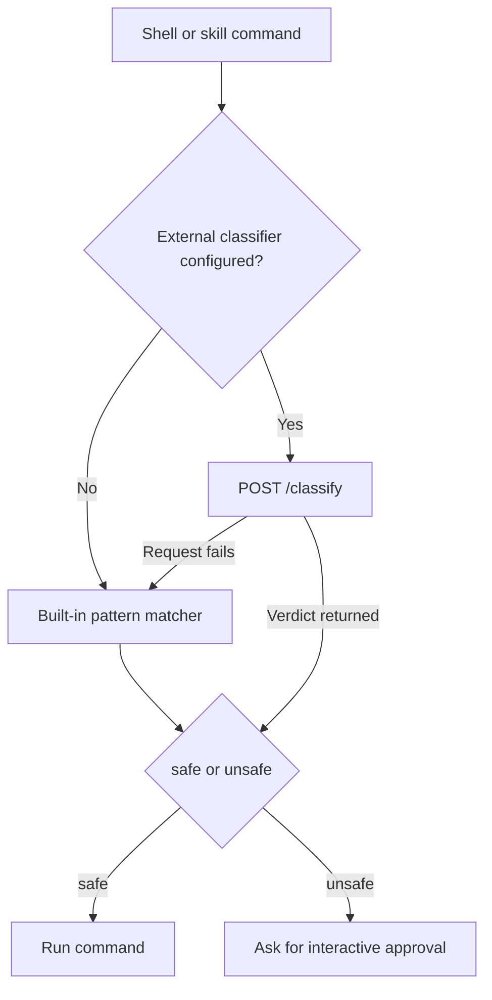

# Shell Command Safety and Classifier

Zay classifies shell commands (`bash` on Linux and macOS, `pwsh` on Windows)
and `skill` command-mode calls before execution. Classification is a
heuristic approval gate, not an operating-system sandbox. See the [README](../../README.md)
for project overview and installation, [Architecture](../ARCHITECTURE.md)
for broader structure, and [Plugin permissions and runtime](../plugins/permissions-and-runtime.md)
for plugin boundaries.

## How command classification works



Zay uses the built-in matcher when no external URL is configured. With an
external URL, it uses that verdict; if the request fails, Zay falls back to
the built-in matcher. A verdict of `unsafe` asks the user to approve or
reject the command. A `safe` verdict runs without a prompt.

The built-in matcher recognizes selected patterns, including some
destructive disk operations (matched wherever `rm`/`dd` appear in command
position: standalone, after separators such as `&&`, and inside command
substitution, backticks, or quotes), critical system-file redirects, shell
fork-bomb forms, and privileged package-management commands. It does not
parse arbitrary commands into a complete security policy and cannot detect
every dangerous action. A command not classified as unsafe may run without
an approval prompt.

Parallel lanes use separate Git worktrees for branch and working-file
isolation. Worktrees do not restrict a process's permissions. The shell tool
validates its requested working directory against the project root, with
symlink resolution best-effort; this does not sandbox filesystem access
after a process starts. Use an operating-system container or virtual machine
when untrusted code needs a stronger boundary.

### External classifier failures and timing

If an external classifier request fails or its response cannot be used, Zay
falls back to the built-in matcher. That fallback is heuristic and does not
guarantee that the command will be stopped.

On POSIX, plain `http://` classifier URLs use a five-second receive deadline
for the response exchange. Connection setup and sending are outside that
deadline. Windows and `https://` URLs use the standard HTTP-client path
without this explicit five-second bound.

## Run the classifier service

The standalone service is in `tools/classifier/` and requires Python
dependencies managed with `uv`. Run the commands below from the repository
root.

```bash
# Start the zero-ML rules preset
uv run -m tools.classifier.server --model rules --port 8765

# Or request the ModernBERT ONNX preset
uv run -m tools.classifier.server --model modernbert --port 8765
```

The service loads its selected model in the background. If downloading
ModernBERT weights fails, the loader logs a warning and falls back to the
rules preset. Other initialization errors are reported by the service;
`/health` returns an error and `/classify` returns HTTP 500. Set
`ZAY_CLASSIFIER_REPO_ID` and `ZAY_CLASSIFIER_REVISION` to choose a model
repository and revision. The rules preset does not download weights.

To run it in Docker:

```bash
docker build -t zay-classifier -f tools/classifier/Dockerfile tools/classifier
docker run -d -p 8765:8765 --name zay-classifier zay-classifier
```

## Configure Zay

Set the endpoint with an environment variable:

```bash
export ZAY_BASH_CLASSIFIER_URL="http://127.0.0.1:8765/classify"
```

In PowerShell:

```powershell
$env:ZAY_BASH_CLASSIFIER_URL = "http://127.0.0.1:8765/classify"
```

Or add it to `~/.config/zay/config.json`:

```json
{
  "bashClassifierUrl": "http://127.0.0.1:8765/classify"
}
```

The same setting is available in the TUI under Settings → Advanced. See the
[configuration reference](../config/file-format-and-schema.md#supported-fields)
for its exact behavior.

## REST API for custom classifiers

Implement `POST /classify` with a JSON request containing the command and
working directory:

```json
{
  "command": "rm -rf /var/log/app.log",
  "cwd": "/home/user/project"
}
```

Return `label` as `safe` or `unsafe`. `score` and `latency_ms` are optional
numeric response fields:

```json
{
  "label": "unsafe",
  "score": 0.98,
  "latency_ms": 12.5
}
```

The service also provides `GET /health` with its loading status. Its
`/classify` endpoint returns an error while the selected model is loading or
if loading failed.

## Available service presets

| Preset | Behavior |
|---|---|
| `modernbert` | ONNX preset; weight-download failures fall back to `rules`. Other initialization errors are reported. |
| `rules` | Local regex and token heuristics; no model weights. |
| `llm-proxy` | Delegates classification to a configured remote LLM. |

For service implementation notes, see [`tools/classifier/README.md`](../../tools/classifier/README.md).
